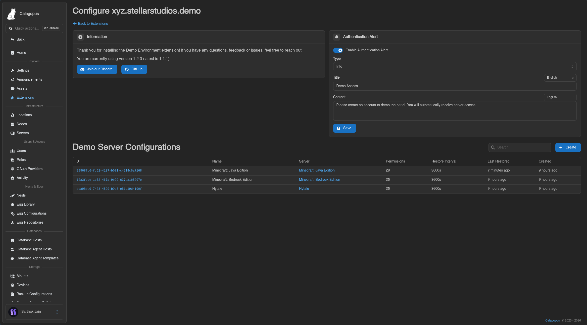
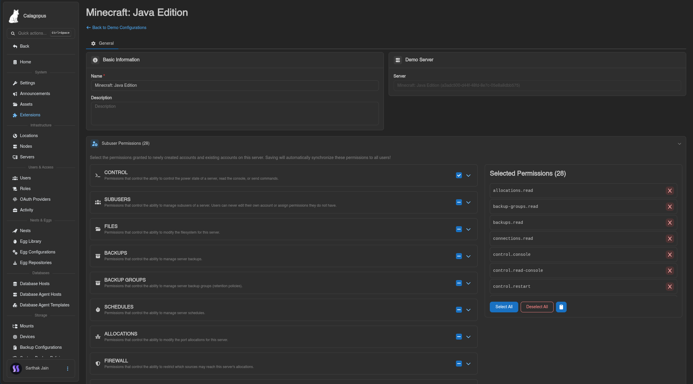
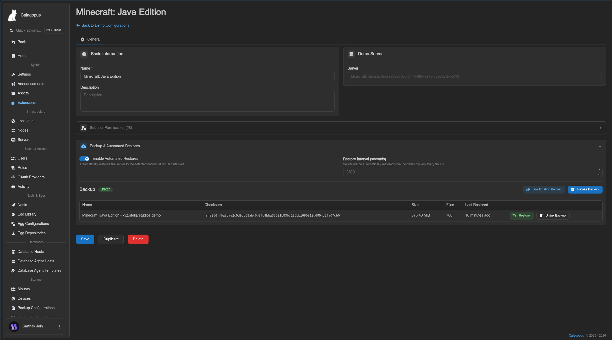
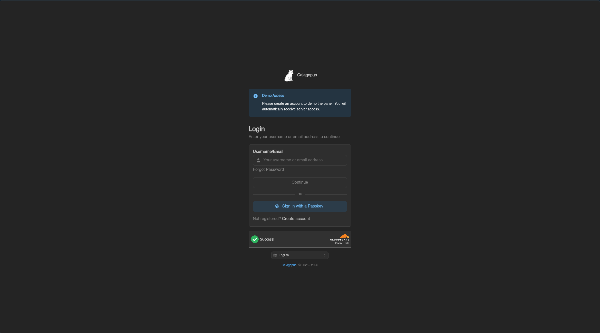

# calagopus-demo-extension

A Calagopus extension that lets you set up public demo panel. It automatically gives newly registered accounts subuser access to configured servers, schedules periodic restores from detached backups, and displays customizable alert on the authentication pages.

## Features

- **Automated Subuser Access**: Automatically grants specified subuser permissions to new users upon account registration. Permissions can also be synced across existing users.
- **Multiple Demo Configurations**: Set up different demo servers with independent permission sets, restore intervals, and backups.
- **Scheduled Restores**: Automatically roll back demo servers at set intervals. Skips restores if no server activity occurred since the last rollback.
- **Configurable Auth Banner**: Display an customizable alert on `/auth/login` and `/auth/register` pages.
- **Multi-language Support**: Supports translations for English, German, French, and Spanish.

## Showcase

### Extension Settings

### Demo Configuration Settings

### Backup & Automated Restores
Link existing detached backups, create new backup, and configure automatic restore intervals with activity detection.

### Login & Register Alert

## License

Copyright © 2026 Sarthak, StellarStudios

Code released under the [MIT License](LICENSE).
